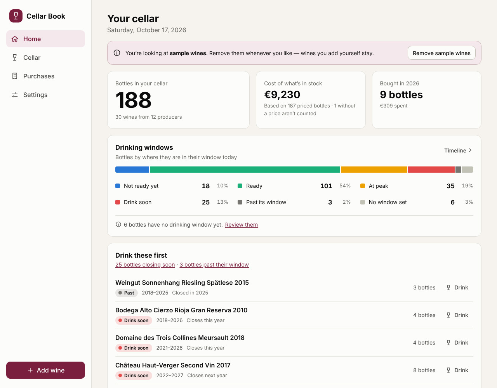
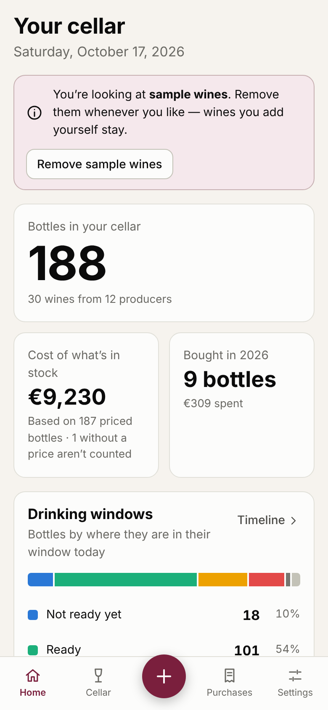
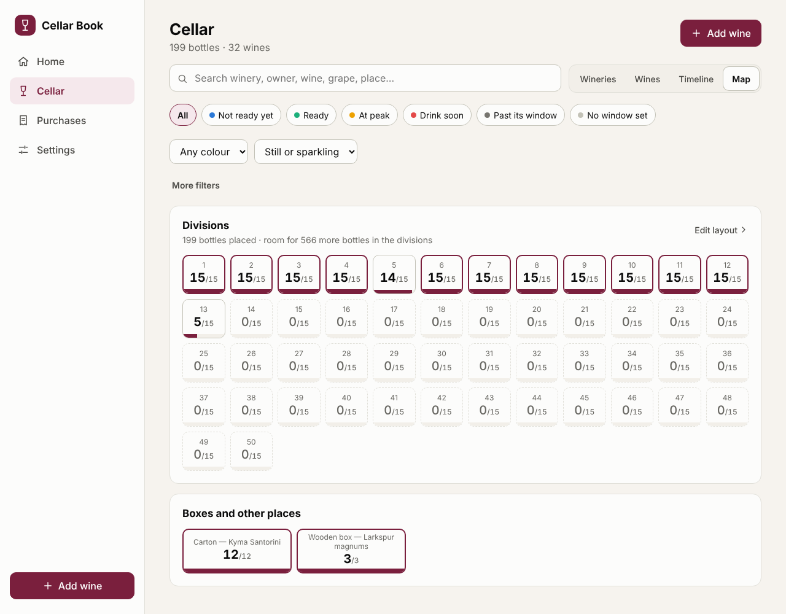
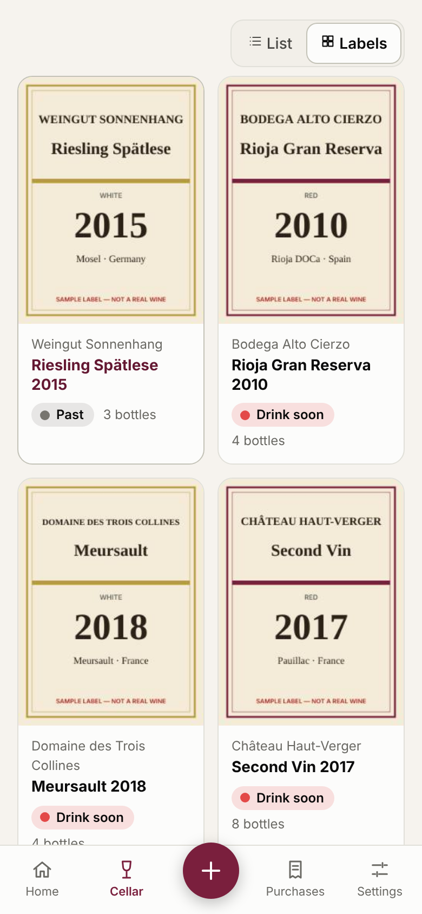
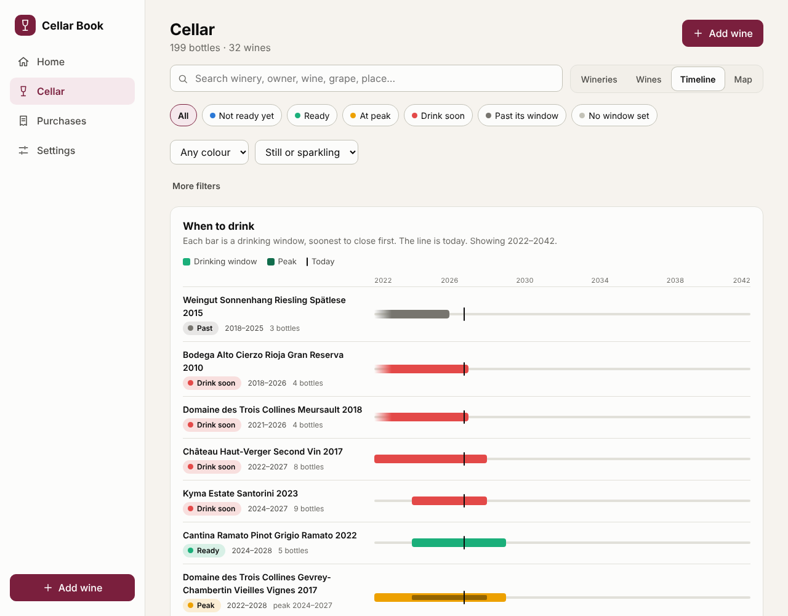
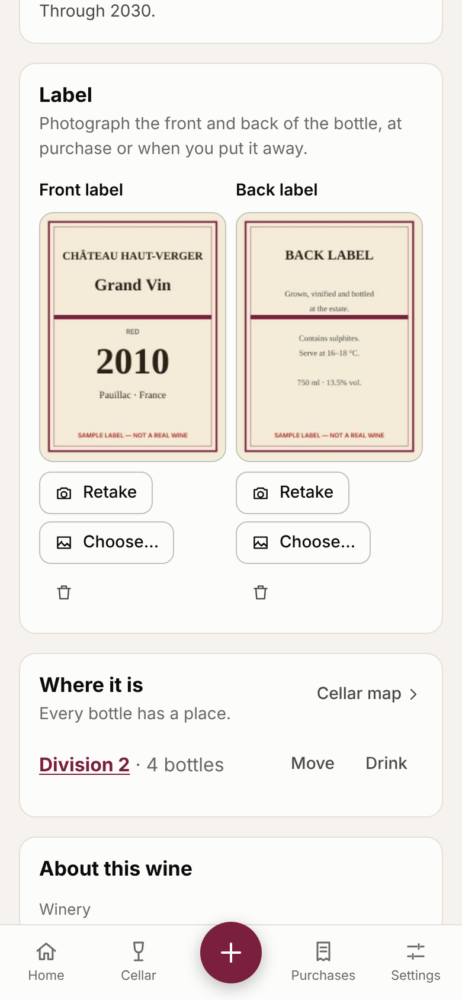

# Cellar Book

A personal wine cellar catalog for the web and your phone. It answers the questions a collector actually asks:

- **What do I own?** Bottles per owner family, winery, bottling and vintage, with colour, still or sparkling, origin and the grape varieties of each bottling.
- **Where is it?** Every bottle can have a place: one of your numbered divisions, or a box on the floor.
- **What does it look like?** Photograph the front and back label once; the cellar becomes a gallery of labels.
- **What did I buy, when, and for how much?** Every purchase is kept with its date, price and merchant.
- **When should I drink it?** Each vintage has a drinking window, and the app shows what is ready, what is at its peak, what is closing soon, and what you have missed.
- **What did I think of it?** A rating from 1 to 20, impressions picked from a table of tasting words (and words of your own), free notes, and the scores of Vivino, Robert Parker or Jancis Robinson, which you record next to yours.

<p>
  
  
</p>

<p>
  
  
</p>

<p>
  
  
</p>

_The screenshots show the built-in sample wines (made-up producers and families, invented prices, drawn labels marked “SAMPLE”)._

## Using it

### Open it and install it

Cellar Book is a web app that installs like a native one, so there is nothing to download from an app store.

1. Open the site once it is published (see [Publishing](#publishing-the-site)).
2. **iPhone / iPad (Safari):** Share → **Add to Home Screen**.
   **Android (Chrome):** menu → **Install app**.
   **Desktop (Chrome or Edge):** the install icon in the address bar.
3. After the first visit it works **offline**, which is handy in a cellar with no signal.

When a new version is available, a banner offers **Update now**. Nothing reloads by itself, so you never lose a half-filled form.

### Add your wines

- **One by one:** tap **+**. The form starts with the label photos, then:
  - **Winery** and, if you like, **Owner family or company** (Antinori, Karamolegos…). One owner can have wineries in several regions and countries; setting it once on a winery applies to all of that winery's wines.
  - **Bottling / cuvée**, the label name.
  - **Colour** (red, rosé, white, orange), and **still or sparkling** as a separate choice, so a sparkling rosé is both. *Sweet* and *fortified* can be added on top.
  - Origin (country, region, appellation) and grape varieties, then the vintage and bottle size, the window, and the bottles you are adding.
- **Remembered for you:** anything you typed before is offered again. When the winery and bottling already exist, their colour, origin and varieties are shown and locked (they are shared by all vintages), so you enter them once per bottling.
- **Same wine again?** Typing a winery, bottling and vintage you already have (any capitalisation, with or without accents) adds the bottles to it instead of creating a duplicate.
- **From a spreadsheet:** *Settings → Spreadsheet → Import a CSV*. You see a preview, including any rows that will be skipped and why, before anything is imported. See [CSV format](#csv-format).
- **Try it first:** the welcome screen offers sample wines, removable at any time without touching your own. A sample wine you add bottles, tastings or reviews to becomes yours and stays when the samples are removed.

### Label photos

On a phone, **Take photo** opens the camera, on the front and on the back of the label; **Choose…** picks from the photo library. On a computer a file chooser opens. Do it when you buy the wine or when you put it away.

- Photos stay on the device, like everything else. They are shrunk (1024 px for reading the label, a small thumbnail for lists) and re-saved as JPEG, which also removes any location data in the photo.
- *Cellar → Wines → Labels* shows the gallery. **More filters → No label photo yet** lists the wines still to do, and the home page counts them under **Loose ends**.
- “Scan” here means photographing the label. There is no barcode reader yet.

### Where it is: divisions, boxes, the map

*Settings → Cellar layout* (or *Cellar → Map → Set up the layout*) creates your places. One step makes divisions 1 to 50 with 15 bottles each; every number can be changed, renamed or resized afterwards. Add floor boxes (wooden or carton, with their own capacity) and anything else, such as a fridge.

- When you add bottles, the form **suggests a place** and you can always change it: the same vintage first, then the same bottling, then the same winery, then the division where the bottles fit best. Boxes are only suggested if the wine is already in one. A division never holds more than its capacity, and you can leave it for later.
- The **map** shows every division as a tile with its count and how full it is; boxes appear below. Search or filter, and the tiles that hold a match light up while the rest fade. Tap a tile to see what is in it, move bottles, or take one out to drink.
- *Not put away yet* lists bottles that have no place, with a **Put away** button each.
- Move bottles from the wine's page or the map. Drinking from a place takes the bottle out of that place; undoing puts it back if there is still room.

### Drinking windows

A drinking window is the range of years in which a vintage is good to drink, **both ends included** (`2024–2030` means from 1 January 2024 to 31 December 2030). Optionally add a **peak** inside it.

| Status | Meaning |
| --- | --- |
| **Not ready yet** | The window has not opened. |
| **Ready** | Inside the window. |
| **At peak** | Inside the window and inside the peak years you gave. |
| **Drink soon** | The window closes this year, or within the next *N* years (you choose *N* in Settings; the default is 1). This outranks "peak": a wine at its peak in its last year is the one to open. |
| **Past its window** | The window has closed. |
| **No window set** | Nothing entered yet. The dashboard counts these so they don't go unnoticed. |

**Estimates are not tasting advice.** When you add a wine you can start from a rule of thumb by aging potential (*Drink young* to *Very long-lived*). These only count forward from the vintage year, they are always marked **est.** in lists, and the mark disappears the moment you change a year yourself. Prefer your own notes or a critic's guidance where you have them.

### Taking bottles out, and what you thought

Tap **Drink** on any wine, in a list, or on the map. Choose which place the bottle comes from, the date, and whether you drank it, gave it away, sold it, or it was spoiled. Everything can be undone from the toast that appears, or later from the wine's page. Bottles in stock are always *bought minus taken out*, so the history and the count can never disagree, and you cannot take out more bottles than you have.

When you drank it, record the tasting:

- **Rating from 1 to 20**, in half points. Leave it out if you don't want to rate. Lists show your average rating per wine.
- **Impressions**: tap words from a table grouped as fruit, floral and herbal, spice, oak and age, earth and mineral, structure, and verdict (*would buy again*, *great value*…). Search the table, or **add a word of your own**; it is kept for next time and listed under *Settings → Tasting words*.
- **Notes**: free text.

All of it can be added or corrected later from the wine's page (*Tastings and history → Edit*).

### Reviews from Vivino, Robert Parker, Jancis Robinson

Each wine's page has a **Reviews** card. **Look it up** opens a search for that exact wine on Vivino, Robert Parker / Wine Advocate and JancisRobinson.com, in a new tab. Then **Add** records what you found: the source, the score on that source's own scale (Vivino out of 5, Parker out of 100, Jancis out of 20), a link back, a short quote or summary, and, if the critic gives one, their drinking window, which you can adopt as yours with one tap.

**Cellar Book does not fetch reviews for you.** Vivino offers no public data, and Wine Advocate and JancisRobinson.com are paid services whose content can't be copied automatically. Searching and recording takes seconds and is always accurate to the page you read. Only `http` and `https` links are accepted.

### Where the numbers come from

- **Cost of what's in stock** values the bottles you still have at the average price you paid for that wine. Bottles with no recorded price are left out and the card says how many.
- **Prices** are in one currency, chosen in Settings. Changing it relabels amounts; it does not convert them.
- **How your cellar matures** shows, for each of the next ten years, how many bottles would be in each status *if you opened none of them*.
- The home page also breaks the cellar down by colour, still or sparkling, country, and owner family or company.

## Your data

**Everything stays on the device you use.** There is no server and no account; the wines and photos are stored in your browser (IndexedDB). This repository and the published site contain none of your data, so it is safe that the repository is public.

That has two consequences you should know about:

1. **It is not synced between your phone and your computer.** Each device has its own cellar. To move or copy it, use *Settings → Back up and restore*: download a backup on one device, restore it on the other. This is manual and replaces the cellar on the receiving device.
2. **Clearing browser data, or losing the device, loses the cellar** unless you have a backup. The app asks the browser to keep its data, and reminds you if you have not backed up in 30 days, but a backup file is the only real safety net. Keep it somewhere that is itself backed up.

### What protects the data while you use it

- A save only goes through if nobody else saved since this page last looked. If you have the app open in two tabs and one is out of date, the old one **does not overwrite** the newer one: it tells you, and offers *Download my version* or *Load the latest*.
- If the browser refuses to open its storage (common in private windows), the app says so and **never shows an empty cellar** that could be saved over the real one. You can retry, or carry on without saving, with a banner reminding you that nothing is kept.
- If the main storage fails while you work, saving continues in a smaller fallback store and you are told.
- If the stored data can't be understood, it is kept untouched and offered for download.
- A picture is never deleted the moment something changes (a photo replaced or removed, a wine deleted, a backup restored): it stays on the device for 30 days after no wine uses it, so a mistake can be taken back, and only then is it cleaned up. *Remove* on a photo offers **Undo**. *Delete everything* removes the pictures at once, after the empty cellar is safely saved.
- Before anything is written, the cellar is checked the way the app itself will read it back; a document that could not be loaded again is refused, so it can never replace the last good copy. Restoring a backup says it is done only once it is saved.
- A half-filled form asks before you leave it (and before you close the tab), so photos taken in the cellar are not lost to a stray tap. If a screen ever crashes, you still get a button to download your cellar.

### Backup file vs. CSV

| | Backup (`.zip` or `.json`) | CSV |
| --- | --- | --- |
| Purpose | Complete copy: wines, purchases, tastings, reviews, layout, settings (and photos in the `.zip`) | Opening your wines in Excel/Sheets, or importing a list |
| Restoring | Replaces the whole cellar (after you confirm) | Adds to the cellar; nothing is removed |
| Includes purchase history and what you drank | Yes | No — one row per wine in stock |
| Label photos | In the `.zip` (tick *Include label photos*) | No |

A backup with photos is a `.zip` holding `cellar.json` and the pictures; without photos it is a plain `.json` that still remembers which picture belongs to which wine, so restoring it on the same device links the pictures that are still there (anywhere else, those wines simply have none, and you are told). Restoring accepts both, and a `.zip` that was opened and zipped again inside a folder, checks them completely before changing anything, and upgrades backups made by the first version of the app (a sparkling wine from then keeps no colour, because it never said which).

### CSV format

The first row names the columns. Only **Producer** (or *Winery*) and **Bottling** (or *Wine*, *Cuvée*) are required; the rest are used when present:

`Producer, Group, Bottling, Vintage, Colour, Sparkling, Style, Type, Size, Country, Region, Appellation, Varieties, Bottles, Price, Purchase date, Merchant, Drink from, Drink to, Peak from, Peak to, Locations, Notes`

- Each row adds that many bottles. Rows for the same producer, bottling and vintage are combined.
- `Group` is the owner family or company. `Colour` is red/white/rosé/orange (also *rouge*, *blanc*, *rosso*…); `Sparkling` is yes/no. A single `Type` column also works (*Red*, *Champagne*, *Sparkling rosé*, *Port*…). A colour that can't be read is imported without one and flagged; it is never guessed.
- `Locations` reads like `Division 12: 6; Wooden box 3: 4`; the number after the colon is how many bottles are there (the export writes it this way too). Places that don't exist yet are created.
- `NV` for non-vintage. `Varieties` can read `Merlot 60%; Cabernet Franc 40%`.
- Dates: `YYYY-MM-DD` or `DD/MM/YYYY` (**day first**), or just a year. Prices accept `12.50` and `12,50`. A dot or comma followed by exactly three digits counts as a thousands separator (`1.500` is fifteen hundred), except after a leading zero (`0.750` is three quarters).
- Commas, semicolons and tabs all work as separators; use semicolons when exporting for Excel set to a European language. Files saved by Excel in a Western code page are read correctly, and the preview tells you when it had to assume one.
- A row the importer cannot use is skipped and listed with its line number and the reason.

## Publishing the site

The site is a static build, hosted for free on GitHub Pages. The included workflow (`.github/workflows/ci.yml`) runs every check on each push, and publishes from `main`.

One-time setup, in the GitHub repository: **Settings → Pages → Build and deployment → Source: GitHub Actions**. After the next push to `main` the site appears at `https://<your-user>.github.io/wines-public-/`.

The build uses relative URLs, so it also works from any other static host or sub-folder.

## For developers

Vite + React + TypeScript, no backend. Node 22 or newer.

```sh
npm install
npm run dev          # local dev server
npm run check        # typecheck + unit tests + production build
npm run e2e          # end-to-end tests (see below)
```

### End-to-end tests

`npx playwright install chromium` once, then `npm run build && npm run e2e`. They run the real production build in a browser and cover the flows that protect your data and the main features: adding and merging wines, drinking and undoing, the cellar layout and placement rules, the map, label photos, tastings and ratings, reviews, owner groups and filters, backup and restore (with and without photos, and from a version-1 file), CSV import, **storage failures injected into the page** (blocked storage, fallback store, two tabs with a stale one), offline use from a sub-path, and layout at 320–390 px wide. Set `PW_CHROMIUM_PATH` to use an existing Chromium instead of Playwright's.

### How it is organised

```
src/domain/    Pure logic with no UI: the data model, drinking-window rules, stock and
               spend maths, the add/edit/delete/placement rules, migration, CSV and backup
               handling. Unit-tested.
src/storage/   IndexedDB persistence (revision-numbered, with a localStorage fallback), the
               photo store, ZIP backups, and the app-wide store.
src/ui/        React pages and components, including the charts, which are plain HTML and CSS.
e2e/           Playwright tests.
```

The cellar is one JSON document (schema 2). A wine is described on the levels collectors speak in:

```
Group (owner family or company, optional)
  └─ Producer (winery)
       └─ Bottling (the label / cuvée: colour, still or sparkling, origin, grape varieties)
            └─ Vintage (a year in a bottle size: drinking window, label photos, notes)
                 ├─ Purchases     (date, quantity, price per bottle, merchant)
                 ├─ Consumptions  (date, quantity, drank / gave away / sold / spoiled,
                 │                 the place it came from, rating 1–20, impressions, notes)
                 ├─ Placements    (how many bottles are in which place)
                 └─ Reviews       (Vivino / Parker / Robinson / other: score, link, critic window)
Locations (divisions, floor boxes, other places, each with an optional capacity)
```

Stock is never stored, only derived (`purchases − consumptions`); placed bottles can never exceed stock nor a place its capacity. Every action that changes data is a pure function in `src/domain/actions.ts` that either returns the new data or explains what is wrong. Label photos live in a separate IndexedDB store, referenced by id, so the cellar document stays small.

Design decisions worth knowing:

- **Years, not dates, for windows.** Nobody knows a window to the month, and whole years keep the rules honest and explainable.
- **Dates may be partial** (`2019`, `2019-05`) because that is often all you remember about an old purchase.
- **A known bottling is never overwritten** by a later entry; blanks are filled, and editing a wine in place is how you change details shared by its vintages.
- **Migration never guesses.** Version 1 data is upgraded without inventing colours, places or families.
- **Unreadable or unreachable stored data is never overwritten.** The app stops saving and waits for you to decide.
- **Charts** use a status palette that was validated for colour-blind separation and contrast in both light and dark mode. Colour is never the only signal: every status has a text label, and each chart has a legend with counts and a "View as table".

## Limitations and ideas

Not built yet:

- **Syncing between devices.** The biggest gap. Options include a small hosted database with a login, or saving the backup file into a cloud folder automatically. Each has trade-offs around accounts and privacy, so it needs a decision before building.
- **Barcode scanning.** Photographing the label is built; reading the barcode to look the wine up is not.
- **Fetching reviews automatically.** See [Reviews](#reviews-from-vivino-robert-parker-jancis-robinson) for why: it is entered by hand, with one-tap searches.
- Several currencies in one cellar.
- Importing wine details (varieties, critic windows) from an online database.
